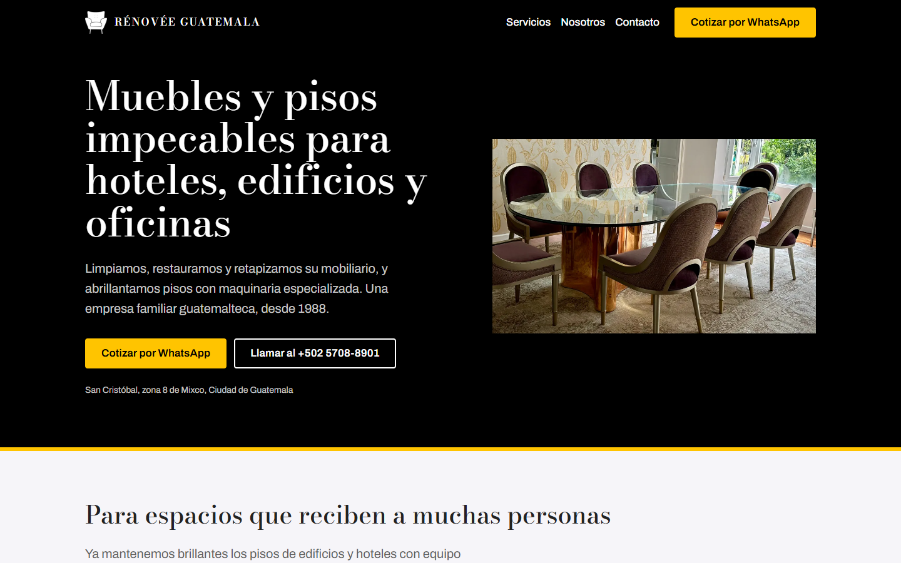

# Rénovée Guatemala

Sitio web de Rénovée Guatemala: limpieza y restauración de muebles y pisos para hoteles,
edificios y empresas en Guatemala.

## Qué hace el sitio

- **Sitio público en español**: inicio, sobre nosotros, contacto, política de privacidad y
  términos de uso. El teléfono, WhatsApp y la dirección aparecen en todas las páginas.
- **Cotizaciones**: los botones de WhatsApp abren una conversación con el 5708-8901, y el
  formulario de contacto guarda cada mensaje como un cliente potencial.
- **Administración** para el dueño y el personal: clientes y mensajes recibidos, la etapa de
  cada cotización (nuevo, contactado, cotizado, ganado, perdido), tareas de seguimiento y
  exportación a Excel (CSV). Está protegida con contraseña, se bloquea tras varios intentos
  fallidos y pide un código de una aplicación de autenticación.

## Cómo se usa

1. Abra la administración con el enlace «Acceso del personal», al pie de cada página.
2. Ingrese su usuario y contraseña, y después el código de su aplicación de autenticación
   (la primera vez, la página muestra un código QR para configurarla).
3. En «Clientes (CRM)» encontrará los mensajes del formulario y podrá darles seguimiento.

## Qué falta confirmar

- El correo electrónico y el horario de atención: todavía no aparecen en el sitio.
- Los textos tomados del sitio actual: servicios, trayectoria (más de 1,500 proyectos y 2,400
  clientes), cargos del equipo y la descripción de empresa familiar.
- La política de privacidad y los términos de uso: son borradores para revisar, idealmente con
  un abogado.

## Seguridad y privacidad

Todas las páginas usan conexión cifrada, el sitio no carga nada de otros sitios web y los datos
de los clientes quedan en la base de datos propia del negocio. Las fotos publicadas no llevan
datos ocultos (ubicación, cámara, autor). Detalles técnicos:
[docs/security/CONTROLS.md](docs/security/CONTROLS.md).

## Próximos pasos

- Publicar el sitio en un servicio de alojamiento y conectar el dominio del negocio.
- Más adelante: catálogo de servicios y reserva de citas en línea.

## Para desarrolladores

Instalación, configuración y pruebas: [docs/DEVELOPER.md](docs/DEVELOPER.md).

## Licencia

El código está bajo la licencia MIT. Las imágenes, logotipos y textos del negocio no lo están:
todos los derechos reservados.
